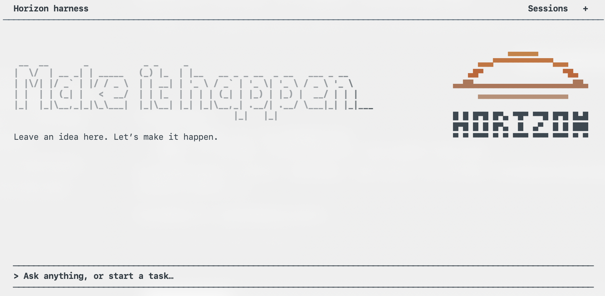
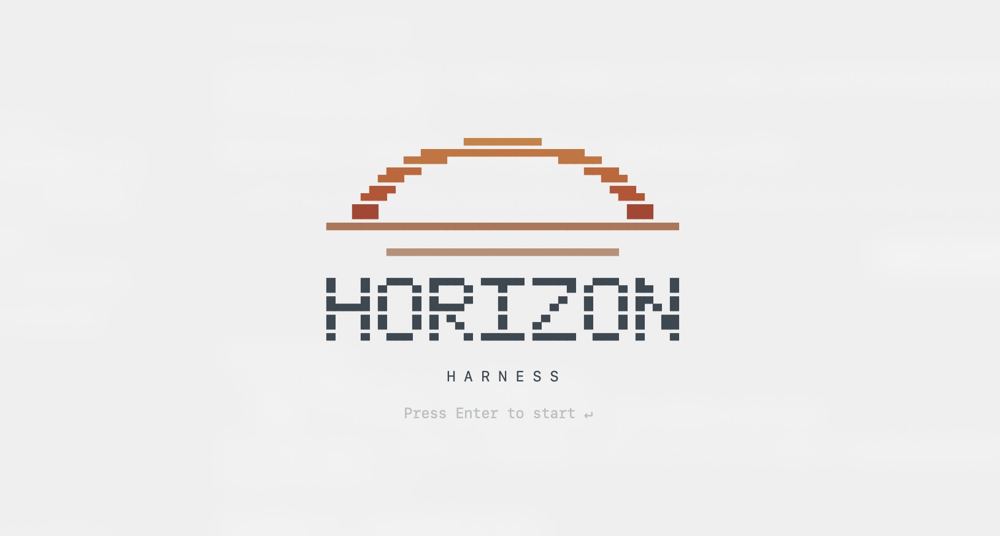
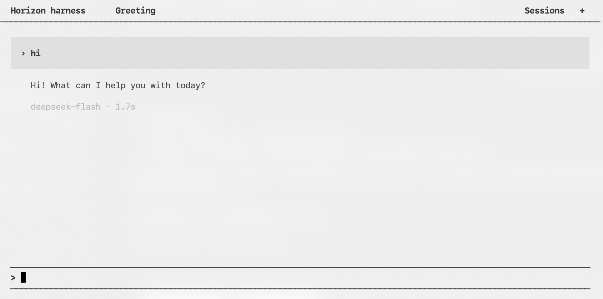

<div align="center">

# Horizon Harness

An AI agent for your terminal.

[English](README.md) · [简体中文](README.zh-CN.md)

</div>



<details>
<summary>More screenshots</summary>




</details>

## Installation

```sh
# Direct install (macOS)
curl -fsSL https://github.com/01ny-yzx/horizon-harness/releases/latest/download/install.sh | sh

# Package managers (choose one)
npm i -g horizon-harness@latest       # macOS / Windows x64, requires Node.js 18+
brew install 01ny-yzx/tap/horizon      # macOS
```

Run `horizon` after installation. Native bundles include Python and support Apple Silicon / Intel Macs and Windows x64.

The curl installer uses `~/.local/bin`; add it to your PATH if prompted. You can also download a [native bundle](https://github.com/01ny-yzx/horizon-harness/releases/latest).

### Run from source

Requires Python 3.11+; Python 3.12 is recommended.

```sh
git clone https://github.com/01ny-yzx/horizon-harness.git
cd horizon-harness
```

macOS:

```sh
python3 -m venv .venv
.venv/bin/python -m pip install -r requirements.txt
.venv/bin/python -m tui
```

Windows PowerShell:

```powershell
py -3.12 -m venv .venv
.\.venv\Scripts\python.exe -m pip install -r requirements.txt
.\.venv\Scripts\python.exe -m tui
```

Press Enter to open the home screen. Use `/models` to choose a model and enter your API Key. The local service starts and stops with the TUI.

## Using Horizon

- Stream responses and follow tool activity in the terminal.
- Work with files, code, Git, documents and configured web search.
- Switch conversations, restore tabs and queue follow-up messages.
- Press `Tab` to switch between `read_only` and `full_access`.
- Use English, Chinese or Japanese. The interface follows your terminal background.

Type `/` to see commands, then use ↑↓ and Enter to select.

| Command | Action |
| --- | --- |
| `/models` | Set the global default model |
| `/session` | Open a previous conversation |
| `/new` | Start a conversation |
| `/search` | Configure web search |
| `/language` | Change the interface language |
| `/help` | Help and keyboard settings |

New conversations use the global default model; existing conversations keep their original model. Enter sends a message; Shift+Enter adds a line. Type `exit` or press `Ctrl+Q` to quit.

## Documentation

[User guide](docs/usage.md) · [Development](docs/development.md) · [Architecture](docs/architecture.md)

## Contributing

Issues and pull requests are welcome. See [CONTRIBUTING.md](CONTRIBUTING.md); report vulnerabilities through [SECURITY.md](SECURITY.md).

## License

[MIT](LICENSE).
