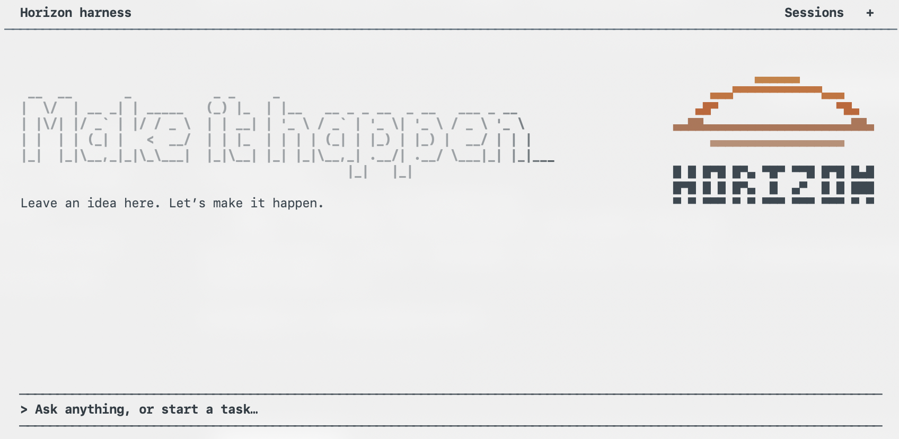
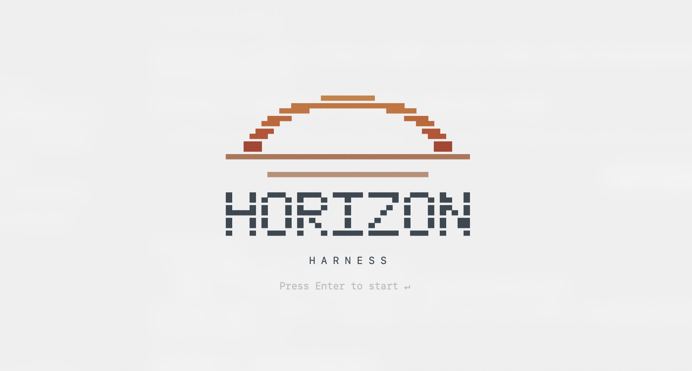
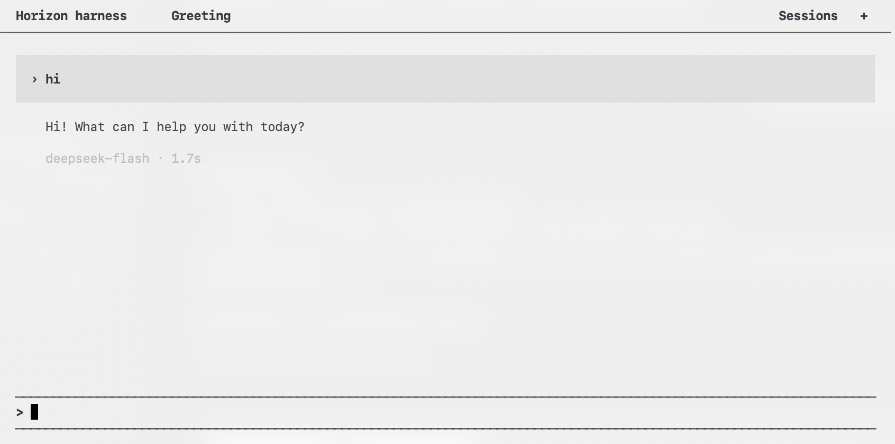

<div align="center">

# Horizon Harness

终端里的 AI 助手。

[English](README.md) · [简体中文](README.zh-CN.md)

</div>



<details>
<summary>更多界面预览</summary>




</details>

## 安装

```sh
# 直接安装（macOS）
curl -fsSL https://github.com/01ny-yzx/horizon-harness/releases/latest/download/install.sh | sh

# 软件包管理器（任选一种）
npm i -g horizon-harness@latest       # macOS / Windows x64，需要 Node.js 18+
brew install 01ny-yzx/tap/horizon      # macOS
```

安装后运行 `horizon`。运行包已包含 Python，支持 Apple Silicon / Intel Mac 和 Windows x64。

curl 默认安装到 `~/.local/bin`，如有提示请将它加入 PATH。也可以直接下载[独立运行包](https://github.com/01ny-yzx/horizon-harness/releases/latest)。

### 从源码运行

需要 Python 3.11+，建议使用 Python 3.12。

```sh
git clone https://github.com/01ny-yzx/horizon-harness.git
cd horizon-harness
```

macOS：

```sh
python3 -m venv .venv
.venv/bin/python -m pip install -r requirements.txt
.venv/bin/python -m tui
```

<details>
<summary>Windows PowerShell</summary>

```powershell
py -3.12 -m venv .venv
.\.venv\Scripts\python.exe -m pip install -r requirements.txt
.\.venv\Scripts\python.exe -m tui
```

</details>

在欢迎页按 Enter 进入首页，通过 `/models` 选择模型并填写 API Key。本地服务随 TUI 自动启动和关闭。

## 使用

- 在终端查看流式回答和工具执行过程。
- 处理文件、代码、Git、文档和已配置的联网搜索。
- 切换历史会话、恢复标签页，任务执行时也能排队发送消息。
- 按 `Tab` 切换 `read_only` 和 `full_access`。
- 支持中文、英文、日文，界面跟随终端背景。

输入 `/` 查看命令，用 ↑↓ 选择、Enter 确认。

| 命令 | 用途 |
| --- | --- |
| `/models` | 设置全局默认模型 |
| `/session` | 打开历史会话 |
| `/new` | 新建会话 |
| `/search` | 配置联网搜索 |
| `/language` | 切换界面语言 |
| `/help` | 帮助与快捷键设置 |

新会话使用全局默认模型，旧会话保留原来的模型。Enter 发送，Shift+Enter 换行；输入 `exit` 或按 `Ctrl+Q` 退出。

## 文档

[使用指南](docs/usage.zh-CN.md) · [开发指南](docs/development.zh-CN.md) · [架构说明](docs/architecture.zh-CN.md)

## 参与贡献

欢迎提交 Issue 和 PR。参与开发请看[贡献指南](CONTRIBUTING.zh-CN.md)，安全问题请通过[安全说明](SECURITY.zh-CN.md)反馈。

## 许可证

[MIT](LICENSE)。另提供[中文参考译文](LICENSE.zh-CN)。
